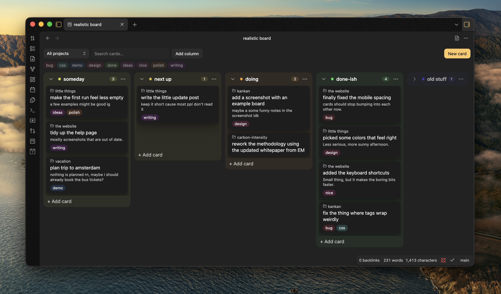

# Kankan

Simple kanban boards stored as plain markdown files.



## Install

1. Open the [Kankan releases](https://github.com/nyzss/kankan/releases) page and download `main.js`, `manifest.json` and `styles.css` from a release.
2. In your vault, create `.obsidian/plugins/kankan/` and put the downloaded files in that folder.
3. In Obsidian, open **Settings → Community plugins**, reload the plugins and enable Kankan.

## Features

- **Create new board** (command or ribbon icon) creates a board with Backlog, Todo, In progress, Done and Archive columns. Archive is collapsed by default.
- Drag cards between columns. Drag a column header to reorder columns.
- Select a card to edit its title, description, project, tags or column. Select a tag chip to filter by that tag.
- Select project pills to filter by one or more projects. Right-click a project pill to give it tags, every card in that project inherits them and matches the tag filter.
- Select **Select** (or shift-click a card) to pick several cards, then **Edit selected** to change their column or project, add or remove tags, or delete them together.
- Double-click a column name to rename it. Use the **⋯** menu to add or delete columns.
- Any note with `kankan: board` in its frontmatter opens as a board. Use **Open as markdown** in the view header to edit the raw file.

## File format

```md
---
kankan: board
---

%% project: Website #work %%

## Todo

- Fix login bug [project:: Website] #urgent
  Users get logged out on refresh

## Archive %% collapsed %%
```

## Development

`npm install`, then `npm run dev`. Parser check: `npx esbuild src/board.check.ts --bundle --platform=node | node`.
